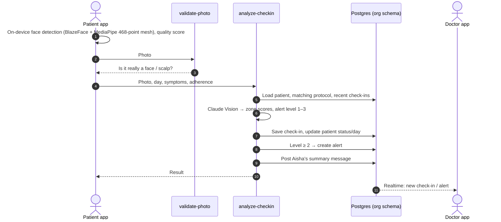

# Care.ai: AI-powered remote patient monitoring for dermatology

**▶ Live demo: https://ihatecodingaf.github.io/carecompanion-poc/** (no sign-up; sample patients)

Patients recovering from acne treatment, laser procedures or hair-loss therapy do a short guided photo check-in from their phone each day. AI scores each face (or scalp) zone, compares it with what's normal for that day of treatment, and flags anything unusual. The doctor sees every patient's progress and open alerts in one dashboard instead of waiting for the next clinic visit.

This repository is the working proof of concept: two installable PWAs, a doctor dashboard, a Supabase/Postgres backend and the AI edge functions.

## Try the demo in 60 seconds

1. Open the [live demo](https://ihatecodingaf.github.io/carecompanion-poc/). On a laptop you'll see both apps side by side.
2. **Patient app:** pick *Priya Sharma* (acne, day 32), type any password, then tap **Check-in** and take or upload a selfie.
3. **Doctor app:** tap *View Patient Reports* → *Dr. Sofia Martinez*. Priya's new check-in, and any alert it raised, are in her timeline.

The demo runs entirely in your browser (see [how the demo works](#how-the-demo-works)), so photos never leave your device. **Reset demo data** restores the original patients.

## What's in here

```
apps/
  patient/     React + Vite PWA. Guided camera check-in, AI results, history, messages, voice nurse "Aisha"
  doctor/      React + Vite PWA (PRECOVERY design). Risk-sorted patients, alerts, patient timeline, add patient from a prescription photo
  dashboard/   Next.js 14 doctor web dashboard (server-side, talks to Postgres directly)
  admin/       Clinic admin app
packages/
  shared/      Shared TypeScript types
  demo-api/    In-browser stand-in for Supabase, used only by the public demo build
supabase/
  migrations/  14 SQL migrations: full schema, functions, RLS
  seed.sql     Demo clinic: 3 doctors, 6 patients, check-ins, alerts, messages, 27 treatment-protocol rows
  functions/   Deno edge functions: analyze-checkin, validate-photo, extract-prescription, upload-to-drive
docs/
  DATABASE.md  Database design: tables, ER diagram, functions, security, setup
demo/          Landing page for the hosted demo
```

## Database

The data model is documented in **[docs/DATABASE.md](docs/DATABASE.md)**: the one-schema-per-clinic multi-tenant design, an ER diagram, every table and column, the value conventions, all 20 database functions and 4 edge functions, the RLS policies, and how to stand up a fresh database.

The short version:

| Table (per clinic, `org_<slug>.*`) | Holds |
|---|---|
| `doctors` | Clinicians at this clinic |
| `patients` | Treatment, condition, current day, status (green/yellow/red), adherence, structured prescription |
| `checkins` | One row per daily photo check-in, with AI headline, summary and per-zone scores |
| `alerts` | Anything the AI thinks the doctor should review |
| `messages` | Patient ↔ doctor ↔ AI nurse thread |
| `disease_protocols` | Day-by-day "what's normal" for each condition, used as AI context |
| `call_sessions`, `call_captures`, `faq_usage` | Voice check-ins with the AI nurse |
| `adherence_log` | Daily product usage |

Shared tables in `public`: `orgs` (clinic registry), `doctor_clinic_map` (doctor ↔ clinic logins), `admin_users`, `data_access_log` (audit).

## How a check-in works



## Tech stack

| Layer | Tech |
|---|---|
| Patient & doctor PWAs | React 18, Vite 5, TypeScript, Zustand, React Router, Tailwind, Workbox (offline) |
| Doctor web dashboard | Next.js 14 (App Router) |
| Backend | Supabase: Postgres, Auth, Storage, Realtime, Edge Functions (Deno) |
| AI | Claude Vision (skin/scalp analysis), Claude Haiku (photo gate, prescription parsing) |
| On-device vision | TensorFlow.js BlazeFace, MediaPipe FaceLandmarker + hair segmenter |
| OCR | OCR.space / DocuPipe → Claude for structuring |

## Run it locally

**Demo mode** (no backend, no keys):

```bash
pnpm install
pnpm --filter @care-ai/patient exec vite --mode demo   # http://localhost:5174
pnpm --filter @care-ai/doctor  exec vite --mode demo   # http://localhost:5175
```

**Against your own Supabase project:**

1. Set up the database as described in [docs/DATABASE.md](docs/DATABASE.md#setting-up-a-fresh-database).
2. Copy `apps/*/.env.example` to `.env` and fill in your project URL and anon key. Set `VITE_APP_MODE=pilot` to use real Claude Vision.
3. `pnpm dev:patient`, `pnpm dev:doctor`, `pnpm dev:dashboard`.

More detail on deployment: [SETUP.md](SETUP.md).

## How the demo works

The hosted demo is built with `vite build --mode demo` ([`scripts/build-demo.sh`](scripts/build-demo.sh)), which turns on [`packages/demo-api`](packages/demo-api):

- The apps' Supabase URL points at a placeholder host, and `demo-api` answers those requests **inside the browser**: sign-in, the same database functions (same inputs and JSON shapes as the SQL versions), and the edge functions.
- Sample data is the project's own `seed.sql`, run through the real migrations in Postgres and exported, so it matches the schema exactly.
- AI analysis uses the same deterministic mock the `analyze-checkin` edge function uses when no API key is set.
- Data is kept in `localStorage`. Both apps are served from the same origin, so a check-in made in the patient app shows up in the doctor app.

Nothing in the real code path changes: without `VITE_DEMO_BACKEND=true` the package isn't even bundled.

Deployment is automatic: pushing to `main` runs [`.github/workflows/demo-pages.yml`](.github/workflows/demo-pages.yml), which builds the demo and publishes it to GitHub Pages.

## Status

Proof of concept. Sample data only; not for clinical use. See the [design notes](docs/DATABASE.md#design-notes-and-suggested-improvements) for the known gaps before a production pilot (indexes, typed columns, auth on the demo dashboard function, HIPAA hosting).
