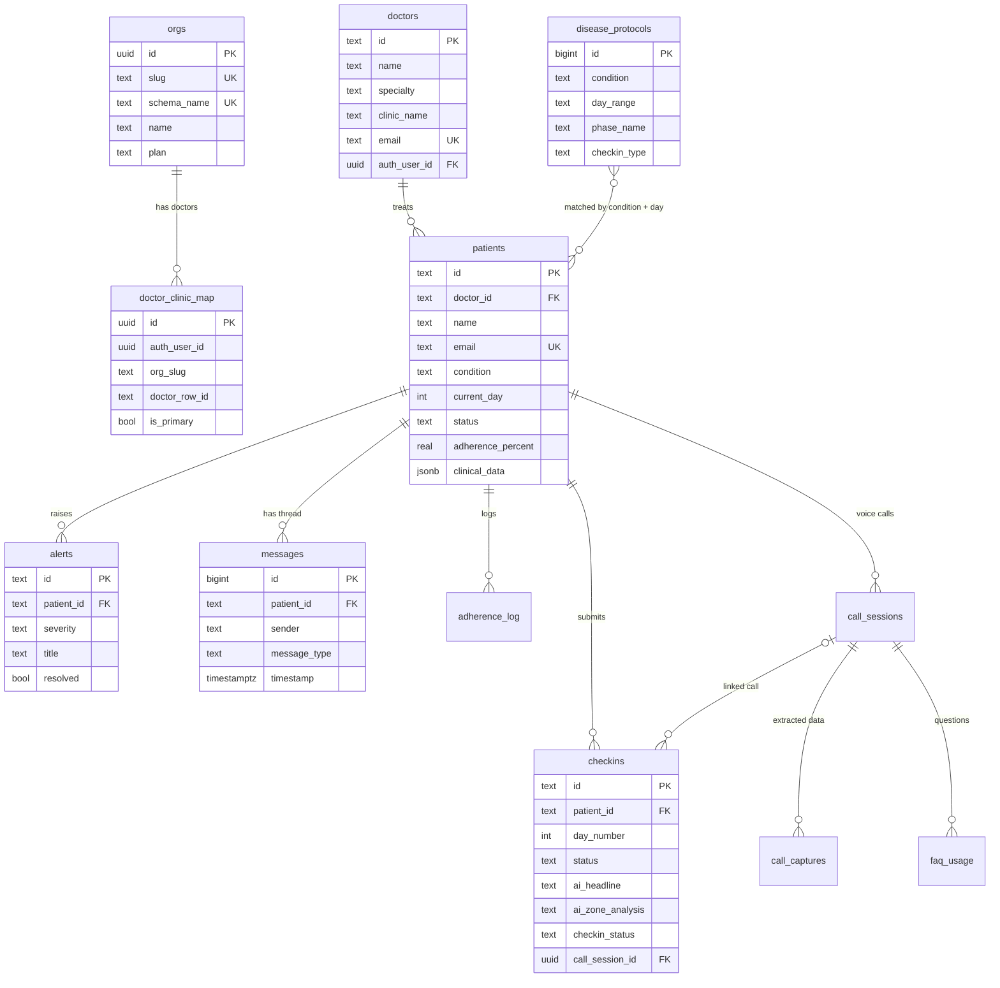

# Database design

Care.ai runs on **Supabase (PostgreSQL 15+)**. Everything below is generated from, and matches, the SQL in [`supabase/migrations/`](../supabase/migrations) and [`supabase/seed.sql`](../supabase/seed.sql).

## The big idea: one schema per clinic

```
public                 ← shared registry: which clinics exist, which doctor belongs where, audit log
org_care_demo          ← all clinical data for clinic "care_demo"
org_bloom              ← all clinical data for clinic "bloom"
...
```

Each clinic ("org") gets its **own Postgres schema** named `org_<slug>` with an identical set of tables. A new clinic is created with one call:

```sql
SELECT public.provision_org('Bloom Clinic', 'bloom');   -- creates schema org_bloom + all tables
```

Why this design:

- **Hard data isolation.** A bug in one query can't leak another clinic's patients; the rows aren't even in the same table.
- **Per-clinic export, backup or deletion** is a single `pg_dump -n org_<slug>` / `DROP SCHEMA`.
- **Trade-off:** schema changes must be applied to every `org_*` schema, and cross-clinic reporting needs a `UNION` across schemas. That's why the apps never query tables directly. They call **database functions** that take an `org_slug` and build the schema-qualified query inside (see [Functions](#database-functions-rpc)).

## Entity relationship diagram



`disease_protocols` has no foreign key. The AI analysis looks up the row whose `condition` and `day_range` match the patient, and uses it as context ("days 14–42 of tretinoin: purge phase is expected").

---

## `public` schema (shared across clinics)

### `public.orgs` — clinic registry

| Column | Type | Notes |
|---|---|---|
| `id` | uuid PK | `gen_random_uuid()` |
| `name` | text | Display name, e.g. "ClearSkin Medical" |
| `slug` | text, **unique** | Used in every API call (`p_org_slug`) |
| `schema_name` | text, **unique** | Always `org_<slug>` |
| `plan` | text | default `'pilot'` |
| `contact_email`, `address`, `city`, `state`, `phone`, `logo_url` | text | Optional profile fields |
| `specialty` | text | default `'multi'` |
| `active` | boolean | default `true` |
| `created_at` | timestamptz | `now()` |

### `public.doctor_clinic_map` — which login can see which clinic

A doctor can work at several clinics. One Supabase Auth user → many `(org_slug, doctor_row_id)` pairs.

| Column | Type | Notes |
|---|---|---|
| `id` | uuid PK | |
| `auth_user_id` | uuid | Supabase Auth user |
| `org_slug` | text | |
| `doctor_row_id` | text | `org_<slug>.doctors.id` |
| `is_primary` | boolean | Clinic shown first after login |
| `created_at` | timestamptz | |

Unique on `(auth_user_id, org_slug)`; indexed on `auth_user_id`.

### `public.admin_users`

Platform admins (`id` = Supabase Auth user id, `email`, `name`, `created_at`).

### `public.data_access_log` — audit trail

`auth_user_id`, `org_slug`, `resource`, `resource_id`, `action`, `ip_address`, `accessed_at`. Indexed on user and on `accessed_at DESC`. Intended for "who viewed this patient's record" audits.

---

## Per-clinic schema `org_<slug>`

### `doctors`

| Column | Type | Notes |
|---|---|---|
| `id` | text PK | Human-readable, e.g. `dr-martinez-001` |
| `name`, `specialty`, `clinic_name`, `clinic_location` | text, not null | |
| `email` | text, **unique** | |
| `phone`, `avatar_url` | text | |
| `auth_user_id` | uuid → `auth.users.id` | Set when the doctor gets a real login |
| `created_at` | timestamptz | |

### `patients`

| Column | Type | Notes |
|---|---|---|
| `id` | text PK | Seed: `demo-patient-acne-1`; registered: `pt-<org>-<epoch>` |
| `doctor_id` | text → `doctors.id` | Treating doctor |
| `name`, `gender` | text, not null | |
| `age` | integer, not null | `0` if unknown |
| `email` | text, **unique** | Login email for the patient app |
| `phone`, `avatar_url` | text | |
| `auth_user_id` | uuid → `auth.users.id` | Patient's Supabase login |
| `condition` | text, default `'acne'` | See [conditions](#value-conventions) |
| `treatment_name` | text, not null | e.g. "Acne Vulgaris Protocol" |
| `treatment_description` | text | |
| `treatment_start_date` | text (`YYYY-MM-DD`) | |
| `current_day` | integer, default `1` | Day of treatment; advanced by each check-in |
| `status` | text, default `'green'` | `green` / `yellow` / `red`, driven by AI alert level |
| `adherence_percent` | real, default `100` | |
| `prescribed_products` | text | JSON array as text, e.g. `["Tretinoin 0.05% (PM)", ...]` |
| `clinical_data` | jsonb, default `{}` | Full structured prescription from OCR (diagnosis, meds, dos/don'ts, vitals...) |
| `notes` | text | |
| `created_at` | timestamptz | |

### `checkins` — one per daily photo check-in

| Column | Type | Notes |
|---|---|---|
| `id` | text PK | `ci-<patient>-d<day>-<epoch>` |
| `patient_id` | text → `patients.id` | |
| `day_number` | integer, not null | Treatment day of this check-in |
| `checkin_date` | timestamptz | |
| `status` | text, default `'green'` | Result of the AI analysis |
| `symptoms_reported` | text | Free text from the patient |
| `adherence_today` | boolean, default `true` | Applied products today? |
| `photo_url`, `photo_label` | text | Supabase Storage URL (`checkin-photos` bucket) |
| `ai_headline`, `ai_summary`, `ai_suggested_actions` | text | Plain-English AI output |
| `ai_zone_analysis` | text (JSON) | Per-zone scores. [Shape below](#zone-analysis-json) |
| `quality_score` | integer | 0–100 photo quality from on-device checks |
| `transcript` | text | Voice note / call transcript, if any |
| `checkin_status` | text, default `'pending_review'` | `draft` → `pending_review` → reviewed |
| `call_session_id` | uuid → `call_sessions.id` | If created from a voice call |
| `doctor_response`, `doctor_action_taken`, `notes` | text | Doctor's review |
| `created_at` | timestamptz | |

### `alerts` — things the doctor should look at

Created by the `analyze-checkin` function when the AI returns alert level ≥ 2.

| Column | Type | Notes |
|---|---|---|
| `id` | text PK | `alert-<checkin id>` |
| `patient_id` | text → `patients.id` | |
| `severity` | text | `yellow` / `red` |
| `title` | text | e.g. "Day 4: Asymmetric Crusting — Right Cheek" |
| `ai_analysis`, `suggested_actions` | text, not null | |
| `patient_context`, `photo_url` | text | |
| `resolved` | boolean, default `false` | |
| `doctor_action`, `instructions_given_to_patient` | text | Filled when the doctor resolves it |
| `created_at` | timestamptz | |

### `messages` — patient ↔ doctor ↔ AI nurse thread

| Column | Type | Notes |
|---|---|---|
| `id` | bigserial PK | |
| `patient_id` | text → `patients.id` | |
| `sender` | text | `patient` / `doctor` / `aisha` (AI nurse) |
| `content` | text | |
| `message_type` | text, default `'text'` | `text` / `ai_analysis` / `image` |
| `timestamp` | timestamptz | |
| `is_read` | boolean | |
| `photo_url`, `metadata` | text | |

### `disease_protocols` — clinical context for the AI

27 seeded rows across 5 conditions. Each row describes one phase of treatment.

| Column | Type | Notes |
|---|---|---|
| `id` | bigserial PK | |
| `condition` | text | |
| `day_range` | text | e.g. `"14-42"` |
| `phase_name` | text | e.g. "Purge phase" |
| `expectations` | text | What's normal in this phase |
| `hotspot_rules` | text | When a zone should be flagged |
| `instructions` | text | Patient guidance |
| `checkin_type` | text, default `'face'` | `face` / `hair` |

### `adherence_log`

`id` bigserial, `patient_id` → patients, `day_number`, `product_name`, `applied` (bool), `logged_at`.

### Voice calls: `call_sessions`, `call_captures`, `faq_usage`

- **`call_sessions`**: one per AI nurse voice call (`patient_id`, `checkin_day`, `condition`, `started_at`, `ended_at`, `duration_seconds`, `status` default `'in_progress'`).
- **`call_captures`**: structured data pulled from a call: `pain_score`, `overall_feeling`, `medications_taken`, `symptoms_reported[]`, `patient_questions[]`, `unanswered_patient_questions[]`, `notes_for_doctor`, full transcript (`jsonb` + text), `per_turn_captures` jsonb.
- **`faq_usage`**: which questions were answered from the FAQ vs escalated.

---

## Value conventions

| Field | Allowed values |
|---|---|
| `patients.condition` | `acne`, `laser_recovery`, `androgenic_alopecia`, `alopecia_areata`, `telogen_effluvium` |
| `patients.status`, `checkins.status` | `green` (on track), `yellow` (watch), `red` (needs review) |
| AI `alert_level` → status | `1 → green`, `2 → yellow` (+ alert), `3 → red` (+ alert) |
| `messages.sender` | `patient`, `doctor`, `aisha` |
| `checkins.checkin_status` | `draft`, `pending_review`, reviewed states |

### Zone analysis JSON

Face check-ins (`checkin_type = 'face'`), each score 0–3:

```json
{
  "forehead":    { "redness": 1, "swelling": 0, "texture_concern": 1, "hotspot": false, "notes": "..." },
  "left_cheek":  { "...": "..." },
  "right_cheek": { "...": "..." },
  "nose_tzone":  { "...": "..." },
  "perioral":    { "...": "..." },
  "chin":        { "...": "..." }
}
```

Hair check-ins (`checkin_type = 'hair'`): zones `crown`, `hairline`, `left_temple`, `right_temple`, `parting_line`, `sides`, each with `density` (0–3), `scalp_visibility` (0–100 %), `hotspot`, `notes`.

---

## Database functions (RPC)

All live in `public`, take an `org_slug`, and are `SECURITY DEFINER`, so they run with the owner's rights and build the `org_<slug>` query internally. The apps call them via `supabase.rpc(...)`.

| Function | Arguments | Returns | Used by |
|---|---|---|---|
| `provision_org` | `p_org_name, p_slug` | org id | setup |
| `list_org_patients` | `p_org_slug` | `id, name, email, condition, current_day, status` rows | patient login |
| `get_patient_by_email` | `p_email, p_org_slug` | patient row | patient app |
| `get_patient_checkins` | `p_patient_id, p_org_slug` | check-ins, newest day first | patient app |
| `get_patient_messages` | `p_patient_id, p_org_slug` | messages, oldest first | patient app |
| `create_checkin_draft` | `p_org_slug, p_patient_id, p_day_number, p_transcript` | check-in id | patient (voice flow) |
| `update_checkin_photo` | `p_org_slug, p_checkin_id, p_photo_url` | — | patient |
| `start_call_session` | `p_org_slug, p_patient_id` | session uuid | patient (voice) |
| `save_voice_call` | `p_org_slug, p_session_id, p_transcript_text, p_full_transcript` | id | patient (voice) |
| `get_doctor_profile` | `p_auth_user_id` | doctor row | doctor app (real login) |
| `get_doctor_clinics` | `p_auth_user_id` | clinics from `doctor_clinic_map` | doctor app (real login) |
| `get_doctor_dashboard` | `p_auth_user_id` | `{patients, alerts, stats}` across all the doctor's clinics | doctor app (real login) |
| `get_doctor_dashboard_bypass` | `p_doctor_id, p_org_slug` | `{patients, alerts, stats}` for one clinic | doctor app (demo login), migration 014 |
| `get_org_dashboard` | `p_org_slug` | whole-clinic overview | admin / fallback |
| `get_org_doctors` | `p_org_slug` | doctors | admin |
| `get_patient_detail` | `p_patient_id, p_org_slug` | `{patient, doctor, checkins, alerts, messages}` | doctor app |
| `send_doctor_message` | `p_patient_id, p_org_slug, p_content, p_doctor_id` | — | doctor app |
| `register_patient` | `p_org_slug, p_doctor_id, p_data jsonb` | `{patient_id, name, condition, treatment_name, follow_up_date}`, also posts a welcome message | doctor app (add patient) |
| `resolve_alert` | `p_alert_id, p_org_slug, p_doctor_note` | — | dashboard |
| `add_doctor_response` | `p_checkin_id, p_org_slug, p_response` | — | dashboard |

## Edge functions (Deno, `supabase/functions/`)

| Function | What it does |
|---|---|
| `analyze-checkin` | Loads the patient + matching protocol + recent history → Claude Vision (or a deterministic mock in `demo` mode) → writes the check-in, updates `patients.status`/`current_day`, inserts an alert when level ≥ 2, posts Aisha's summary message. Keeps the **5 most recent** check-ins per patient and deletes older ones with their photos. |
| `validate-photo` | Quick Claude Haiku gate: "is this actually a face / scalp photo?" before the expensive analysis. Fails open. |
| `extract-prescription` | Turns OCR text of a prescription into structured patient JSON (Claude). |
| `upload-to-drive` | Stores intake photos in Google Drive; falls back to Supabase Storage. |

Storage buckets: `checkin-photos` (public read), `patient-photos`, `app-assets`.

## Security

- **Row Level Security** (`002_auth_and_rls.sql`) is enabled on every clinic table. Patients see only their own `patients` / `checkins` / `messages` / `alerts` / `adherence_log` rows (matched on `auth_user_id`); authenticated users can read `doctors` and `disease_protocols`; doctors can read their patients.
- The **apps go through `SECURITY DEFINER` functions**, which bypass RLS by design. Each function is therefore the security boundary and should check the caller (`auth.uid()`) owns the data it's asked for.
- ⚠️ `get_doctor_dashboard_bypass` and the doctor app's demo login skip authentication entirely. They exist for demos only. **Revoke `EXECUTE` on it from `anon` before handling real patient data.**
- Health data: production use needs a BAA-covered Supabase plan (HIPAA) or equivalent, and the `data_access_log` table should be populated on every patient-record read.

## Setting up a fresh database

```bash
supabase link --project-ref <your-project>
supabase db reset          # runs migrations 001 → 014, then seed.sql
supabase functions deploy analyze-checkin validate-photo extract-prescription upload-to-drive
supabase secrets set ANTHROPIC_API_KEY=...
```

Or paste each file from `supabase/migrations/` into the SQL editor **in order**, then `seed.sql`. `002_auth_and_rls.sql` needs Supabase's `auth` schema, so it only runs on a real Supabase project.

## Design notes and suggested improvements

Found while documenting the schema, roughly in priority order:

1. **Add indexes on foreign keys.** `checkins.patient_id`, `messages.patient_id`, `alerts.patient_id` and `adherence_log.patient_id` have no index; every patient timeline query is a full scan once a clinic grows.
   `CREATE INDEX ON org_<slug>.checkins (patient_id, day_number DESC);` and the same for the others.
2. **Use proper types.** `ai_zone_analysis` and `prescribed_products` are JSON stored as `text`, so use `jsonb`. `treatment_start_date` is `text` and should be `date`.
3. **Constrain enums.** `status`, `severity`, `sender`, `condition` accept any string. Add `CHECK (status IN ('green','yellow','red'))` etc., or Postgres enums.
4. **Rethink the 5-check-in retention.** `analyze-checkin` deletes everything but the last 5 check-ins. That limits storage cost but loses the clinical history doctors usually want. Archive old photos to cold storage instead of deleting the rows.
5. **Keep migrations complete.** `007_bypass_auth_two_doctors.sql` is empty. The second demo doctor and the bypass function were created by hand in the old project; they're now captured in `014_*.sql` and `seed.sql`.
